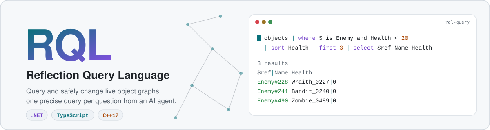

<p align="center">
  <picture>
    <source media="(prefers-color-scheme: dark)" srcset="docs/assets/hero-dark.svg">
    
  </picture>
</p>

<p align="center">
  <a href="https://github.com/IvanMurzak/RQL/actions/workflows/ci.yml"></a>
  <a href="https://www.nuget.org/packages/com.IvanMurzak.Rql"></a>
  <a href="LICENSE.md"></a>
  <a href="https://ai-game.dev/docs/rql"></a>
</p>

<p align="center">
  <b>A pipeline language and a versioned QueryPlan protocol for querying and safely changing live object graphs</b><br>
  (game worlds, editor and application state) from AI agents. Runtimes for <b>.NET</b> (reference), <b>TypeScript</b>
  and <b>C++17</b>, all checked against one set of golden vectors.
</p>

<p align="center">
  <a href="https://ai-game.dev/docs/rql"><b>Documentation</b></a> ·
  <a href="spec/semantics.md">Spec</a> ·
  <a href="RESULTS.md">Results</a>
</p>

## Contents

- [Why RQL](#why-rql)
- [How a query runs](#how-a-query-runs)
- [Quick start](#quick-start)
- [The language at a glance](#the-language-at-a-glance)
- [Safe mutations](#safe-mutations)
- [Runtimes](#runtimes)
- [Build and test](#build-and-test)
- [Documentation](#documentation)
- [License](#license)

## Why RQL

An agent that inspects a running game through "find object / dump as JSON / set field" tools spends many calls and
tokens to answer one question. RQL lets it ask the question directly:

```text
objects | where $ is Enemy and Health < 20 | sort Health | first 3 | select $ref Name Health
```

```text
3 results
$ref|Name|Health
Enemy#228|Wraith_0227|0
Enemy#241|Bandit_0240|0
Enemy#490|Zombie_0489|0
```

- **One call per question.** Filters, projections, sorting, graph walks and aggregates run inside the host, next to the
  objects.
- **Live objects, late encoding.** Executors read live objects through reflection and encode only the rows that survive,
  never a serialized copy of the world.
- **Built for agents.** Compact `|`-separated rows, stable `Type#id` references, and diagnostics with hints
  (`did you mean Health?`) that let the model correct itself.
- **Safe writes.** `set` and `call` are opt-in and all-or-nothing, with dry-run receipts ([details](#safe-mutations)).
- **Measured.** With a DeepSeek V4.1-Flash agent, a task set written after tuning was frozen (n=90) scores **100%**,
  while a conventional reflection-tool baseline (find / dump-object-as-JSON / set / call) scores 66.7% at **40× the
  cost per success**. Method, held-out numbers and caveats: [`RESULTS.md`](RESULTS.md).

## How a query runs

<p align="center">
  <picture>
    <source media="(prefers-color-scheme: dark)" srcset="docs/assets/pipeline-dark.svg">
    
  </picture>
</p>

Text is parsed into a canonical, versioned **QueryPlan** (JSON). Plans are the contract between runtimes: a host can
parse in one runtime and execute in another, for example a .NET sidecar that sends plans to a C++ executor inside
Unreal.

<p align="center">
  <picture>
    <source media="(prefers-color-scheme: dark)" srcset="docs/assets/architecture-dark.svg">
    
  </picture>
</p>

## Quick start

### .NET (NuGet)

```bash
dotnet add package com.IvanMurzak.Rql
```

One package (`Rql.Contracts` + `Rql.Parser` + `Rql.Execution`), targets `netstandard2.1` and `net8.0`.

```csharp
using Rql;
using Rql.Execution;

var engine = new RqlEngine()
    .AddSource("enemies", () => world.Enemies, "every enemy in the level");

QueryResult r = engine.Execute("enemies | where Health < 20 | sort Health | select $ref Name Health");
Console.WriteLine(AgentFormat.Render(r, OutputFormat.Table));   // or OutputFormat.Json

engine.Mutations.Enabled = true;   // host switch; every request must still opt in
engine.Execute("enemies | where Health < 10 | set Health = 100",
    options: new QueryOptions { AllowMutation = true, DryRun = true });
```

Members are read through `System.Reflection`. Attributes shape the model: `[RqlId]`, `[RqlDisplay]`, `[RqlReadOnly]`,
`[RqlReference]` (non-owning link), `[RqlIgnore]`, `[RqlDescription]`, and `[RqlCallable]` to allow a method in `call`.
Type adapters and modules customize how host types are read, written and shown
([docs/type-adapters.md](docs/type-adapters.md)).

### TypeScript

The packages (`@rql/contracts`, `@rql/parser`, `@rql/execution`) are not on npm; build them from source:

```bash
cd typescript && npm install && npm test
```

```ts
import { RqlEngine, TypeModel, t } from '@rql/execution';

const types = new TypeModel().register(Enemy, {
  members: [{ name: 'Id', type: t.int }, { name: 'Name', type: t.string }, { name: 'Health', type: t.int }],
});
const engine = new RqlEngine({ types }).addSource('enemies', () => enemies);
engine.execute('enemies | where Health < 20 | sort Health | select $ref Name Health');
```

TypeScript types are erased at runtime, so classes are described with descriptors (undeclared objects fall back to
their own properties). Details: [typescript/README.md](typescript/README.md).

### C++17

A dependency-free CMake library that executes QueryPlans; no RTTI required, built for Unreal Engine 5.5+ hosts. It has
no text parser by design ([ADR-0003](docs/decisions/0003-no-cpp-text-parser.md)): a .NET or TypeScript side parses.

```cpp
rql::TypeRegistry reg;
reg.object<Enemy>("Enemy").member("Id", &Enemy::Id).member("Name", &Enemy::Name).member("Health", &Enemy::Health);

rql::Engine engine(reg);
engine.add_object_source("world", &world);
rql::QueryResult r = engine.execute_json(plan_json, budgets, options);
```

Details: [cpp/README.md](cpp/README.md).

### Try it without writing a host

A deterministic sandbox world (game objects and app data) ships with a CLI (needs the .NET 10 SDK):

```bash
scripts/rql-sample "objects | where \$ is Enemy | group-by Faction"
scripts/rql-sample plan "objects | where Health < 20 | first 3"     # the canonical QueryPlan JSON
scripts/rql-sample schema                                           # what an agent's schema tool returns
scripts/rql-sample repl
```

## The language at a glance

A query is a **source** followed by `|`-separated **stages**. Inside a stage, bare names are members of the current
item and `$` is the item itself.

```text
# sources: registered roots, paths into them, or references
world.Assets["prefab/house"] | recurse Dependencies max-depth=16 | where Id != "prefab/house" | select Id
ref("Enemy#233") | select Name Health Transform.Position

# filters: comparisons, type tests, string and list operators, collection methods
objects | where $ is Enemy and Faction in ["Undead", "Bandits"] | avg Health
objects | where $ is Enemy and Name matches "^Orc_0\d+$" | count
objects | where Components.any($ is LightComponent and Enabled == false) | count

# projections, aggregation, graph walks
world.Scenes | select Name n=Objects.count()
objects | where $ is Enemy | group-by Faction | sort count desc
world.Scenes | get Objects | recurse Children max-depth=16 | where Name starts-with "Chest" | first 2 | select $path

# introspection
objects | where $ is Enemy | first 1 | describe
```

| Stage | Does |
|---|---|
| `where e` | keep items where `e` is true (three-valued logic: `missing` ≠ `null` ≠ error) |
| `select [n=]e …` | project to rows; `$ref`, `$path`, `$type` are built in |
| `sort k [asc\|desc], …` · `first [n]` · `skip n` · `distinct [e]` | order and slice; `first` stops pulling items upstream |
| `get e` | replace each item by `e`, flattening lists |
| `recurse [via …] [max-depth=N]` | cycle-safe depth-first walk over owning members |
| `group-by e` · `count` · `sum/min/max/avg e` | aggregate |
| `describe` | the schema of the items' runtime types |
| `set p = e, …` · `call m(args)` | mutation (see below) |

Operators: `== != < <= > >=`, `and or not`, `in`, `is Type`, `is null`, `contains`, `starts-with`, `ends-with`,
`matches`, `+ - * / %`. Collection methods: `any all count sum min max avg first keys values`. Functions:
`len lower upper abs round floor ceil sqrt pow min max has append insert remove-at without`. Hosts add namespaced
sources, functions and stages (`myapp.fn(...)`).

Mistakes come back as diagnostics the agent can act on:

```text
warning unknown-member: no member 'Helth' on Enemy - hint: did you mean Health?
```

Full grammar and semantics: [`spec/grammar.ebnf`](spec/grammar.ebnf), [`spec/semantics.md`](spec/semantics.md).

## Safe mutations

```text
ref("Enemy#233") | set Health = MaxHealth, Transform.Position.y = Transform.Position.y + 2
objects | where $ is Enemy and Health < 5 | first 2 | call Heal(25)
```

```text
DRY RUN - nothing changed; 2 results
$ref|member|old|new
Enemy#233|Health|1|90
Enemy#233|Transform.Position.y|25.52|27.52
```

- Writes need the host switch **and** a mutation request; a mutation request must end in `set` or `call`.
- All-or-nothing: every target is validated before the first write, with rollback on failure. Dry runs return the
  same receipt without changing anything.
- Identity members are read-only, `call` only reaches allowlisted methods, and budgets cap targets, rows, depth and
  time. See [docs/security-and-permissions.md](docs/security-and-permissions.md).

## Runtimes

| | .NET | TypeScript | C++17 |
|---|---|---|---|
| Text parser | ✅ reference | ✅ identical plans | — (by design) |
| Executor, mutations, budgets, diagnostics | ✅ | ✅ | ✅ |
| Reflection model | `System.Reflection` + attributes | descriptors + dynamic fallback | `TypeRegistry` descriptors, no RTTI |
| Agent table format | ✅ | JSON only | JSON only |
| Golden vectors | all | all | all plan cases (text-only cases skipped) |
| Distribution | NuGet `com.IvanMurzak.Rql` | source | source (CMake) |

The QueryPlan protocol version is `0.1` ([spec/versioning.md](spec/versioning.md)); packages version independently.
Conformance counts and every gap between runtimes: [docs/feature-matrix.md](docs/feature-matrix.md).

RQL powers the query tools of [AI Game Dev](https://ai-game.dev) for Unity, Unreal Engine and Godot. The library itself
has no dependency on any engine, MCP or hosted service.

## Build and test

Requirements: .NET SDK 10, Node.js ≥ 22, CMake ≥ 3.20 with a C++17 compiler.

```bash
scripts/test-all.sh        # everything: .NET, TypeScript, C++, conformance, task self-check
                           # Windows / PowerShell: scripts/test-all.ps1
dotnet test dotnet/Rql.slnx
dotnet run --project dotnet/Rql.Conformance -- check
(cd typescript && npm install && npm test)
cmake -S cpp -B cpp/build && cmake --build cpp/build && ctest --test-dir cpp/build
```

On macOS without admin rights, install the SDK with
`curl -sSL https://dot.net/v1/dotnet-install.sh | bash -s -- --channel 10.0 --install-dir ~/.dotnet`; the scripts pick
up `~/.dotnet` automatically.

## Documentation

| | |
|---|---|
| [ai-game.dev/docs/rql](https://ai-game.dev/docs/rql) | user guide on the website |
| [`spec/`](spec) | grammar (EBNF), normative semantics, JSON schemas, versioning |
| [`docs/architecture.md`](docs/architecture.md) | layers, design points, integration path |
| [`docs/type-adapters.md`](docs/type-adapters.md) | shaping how host types are read, written and shown |
| [`docs/agent-tool-contract.md`](docs/agent-tool-contract.md) | the `rql_query` / `rql_mutate` / `rql_schema` tool surface |
| [`docs/security-and-permissions.md`](docs/security-and-permissions.md) | mutation policy, budgets, limits |
| [`docs/feature-matrix.md`](docs/feature-matrix.md) | per-runtime status |
| [`docs/evaluation-methodology.md`](docs/evaluation-methodology.md) · [`RESULTS.md`](RESULTS.md) | how the agent evaluation works and what it measured |
| [`docs/decisions/`](docs/decisions) | architecture decision records |

Repository layout: `spec/` · `fixtures/` (golden vectors) · `dotnet/` · `typescript/` · `cpp/` · `evaluation/` (agent
evaluation harness) · `docs/` · `unity/` (Unity-MCP experiment). Contributor and agent rules: [`AGENTS.md`](AGENTS.md).

## License

[PolyForm Shield 1.0.0](LICENSE.md): free to use, including in commercial products, except to provide a product that
competes with the licensor's products ([ADR-0007](docs/decisions/0007-license.md)).
